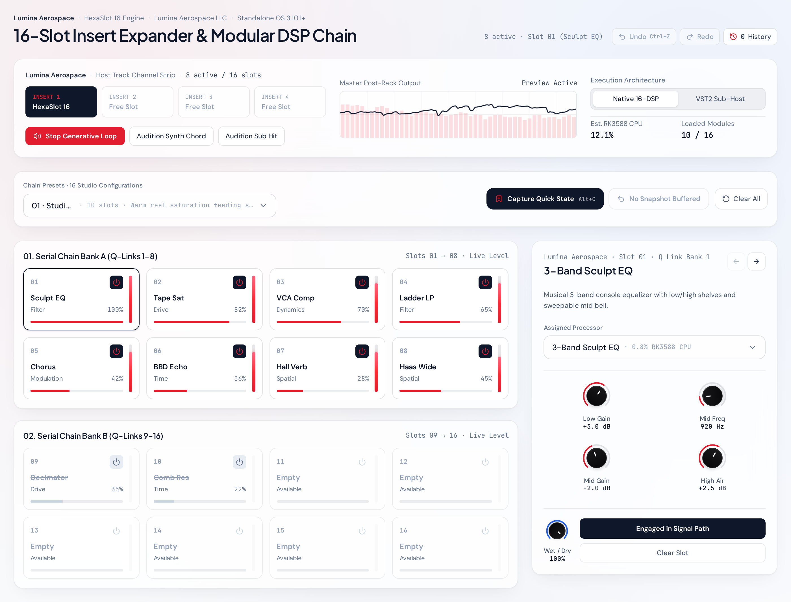
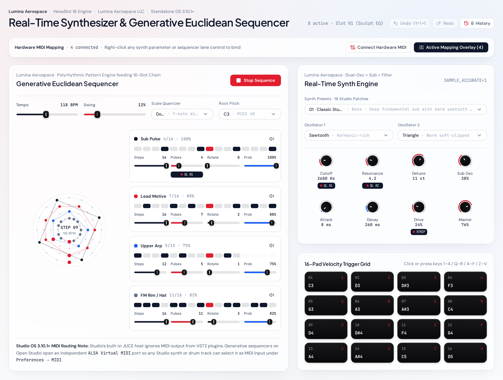
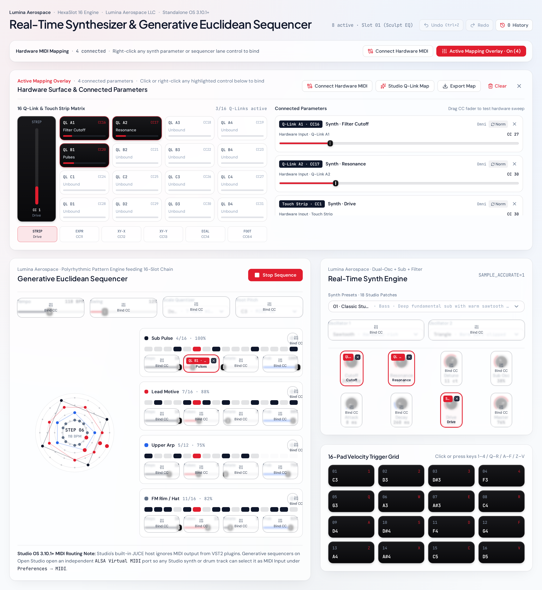

# HexaSlot 16 — 16-slot modular insert expander & generative synth for the Akai MPC



**Lumina Aerospace LLC.** A native MPC OS plugin and touchscreen workstation combining a **16-slot modular channel insert expander**, a **real-time dual-oscillator synthesizer**, and a **4-lane generative Euclidean sequencer** with **16 factory insert chains** and **18 studio synth programs**.

---

## Architecture & Features

- **4-to-16 channel insert expansion:** Occupies a single insert slot (`Slot 1 of 4`) and expands it into **16 serial modular DSP slots** paged across **Q-Link Bank A (Slots 01–08)** and **Q-Link Bank B (Slots 09–16)** with real-time per-slot signal level metering.
- **12 modular DSP processors:** Resonant Ladder Filter, Reel Tape Saturator, Stereo BBD Echo, Dense Hall Reverb, SP-1200 Decimator, Bus VCA Compressor, Juno-Style Chorus, 3-Band Sculpt EQ, West-Coast Wavefolder, Carrier Ring Modulator, Haas Stereo Imager, and Tuned Comb Resonator.
- **Quick Slot Configuration (`Alt+C` / `Alt+R`):** Capture the current 16-slot rack layout into a temporary buffer and restore it in one click for instant A/B comparisons.
- **Real-time dual-oscillator + sub synth:** Sample-accurate (`SAMPLE_ACCURATE=1`) subtractive engine with pre-filter drive, ADSR envelope, resonant filter, and a 16-pad velocity trigger grid.
- **4-lane generative Euclidean sequencer:** Bjorklund pattern generator with concentric geometry wheel, Steps, Pulses, Rotation, Probability, Scale Quantizer, Swing, and independent **ALSA Virtual MIDI** port output.
- **Hardware MIDI mapping & active overlay (`Alt+M`):** Right-click any synth parameter or sequencer lane control to bind Q-Link Banks A–D (`CC 16–31`), Touch Strip (`CC 1`), XYFX, or Data Dial via MIDI Learn or direct assignment.
- **Global 60-step command history (`Ctrl+Z` / `Ctrl+Shift+Z`):** Unified Undo/Redo timeline across the 16-slot Rack, Synth, Sequencer, and MIDI mappings.

---

## The factory library



**16 multi-slot insert chains** covering dub stacks, 12-bit boom-bap grit, West-Coast wavefolding, Detroit techno bus glue, cassette drift, Berlin sequencer rigs, UK garage transient shaping, industrial ring matrices, neo-soul silk, ambient shimmer halls, acid 303 saturation, mastering chains, sub-bass sculpting, glitch combs, wide synthwave chorusing, and full 16-slot cascades.

**18 studio synth programs** compiled for instant zero-I/O patch switching across Bass (`MPC Sub Anchor`, `SubZero Reese`, `Moog Booty Bass`, `Acid 303 Squelch`), Stabs & Keys (`Detroit Poly Stab`, `Warm Juno Brass`, `Lo-Fi Keys Wobble`, `UKG Organ Donk`, `Dub Chord Echo`), Plucks, Arps & Leads (`West-Coast Pluck`, `Glass Bell Tone`, `Berlin Arp Pulse`, `Hyper Saw Lead`, `Karplus Kalimba`, `Industrial Buzz Lead`), and Pads (`Dusty Tape Pad`, `Velvet String Pad`, `Celestial Drone Pad`).



---

## Install

Unzip the release and copy the folder `Lumina Aerospace LLC - VST - HexaSlot 16` into `VST2 Plugins` on the MPC's drive. The release archive targets both **Gen2 (`aarch64` — MPC Live III / XL / One G2)** and **Gen1 (`armv7` — MPC Live II / One / X / Force)**.

Third-party plugins need **MPC OS 3.10.1** or later, and **Preferences → Enhancements (Beta) → Enable Enhancements** and **External Plugin Support** both switched on.

---

## Files

```text
docs/screenshots/     plugin UI screens (rack, synth & sequencer, MIDI mapping)
src/                  workstation UI, DSP catalog, Open MPC manifest & C engine generator
index.html            application entry point
package.json          Node/Vite workspace manifest
LICENSE               MIT license
```

Generated Open MPC release bundle files (via **Cloud SDK Export**):
- `vst/vst.json` (`STATE_MAX = 65536`, `HAS_DISPLAY_REV = 1`, `DISPLAY_REV_NO_UPDATE = 1`)
- `vst/params.json` (append-only Bank 1 & Bank 2 Q-Link parameter layout)
- `vst/layout.conf` (2×8 Q-Link touchscreen skin layout)
- `src/engine.c` (`mpc_engine_render` 44.1 kHz / 128-frame serial C DSP chain)
- `.github/workflows/mpc-release.yml` (Docker `armv7` & `aarch64` build + ASan/UBSan test pipeline)

---

## Build

Export the Open MPC bundle from **Cloud SDK Export**, then build via the [Open MPC](https://open-mpc.github.io/workflow.html) toolchain (`arm64v8/gcc:12-bookworm` & `arm32v7/gcc:11-bullseye`):

```bash
export MPC_VST="/path/to/mpc-vst-plugins"
"$MPC_VST/tools/build_port.sh" vst/vst.json aarch64
"$MPC_VST/tools/test_port.sh" vst/vst.json aarch64
python3 "$MPC_VST/tools/release.py" vst/vst.json --arch aarch64 --out dist/
```

Local workstation UI build:

```bash
npm install
npm run lint
npm run build
```

---

## License

MIT, Copyright (c) 2026 Lumina Aerospace LLC. See `LICENSE`.

## Contact

Lumina Aerospace LLC — owner@luminousworksllc.com
